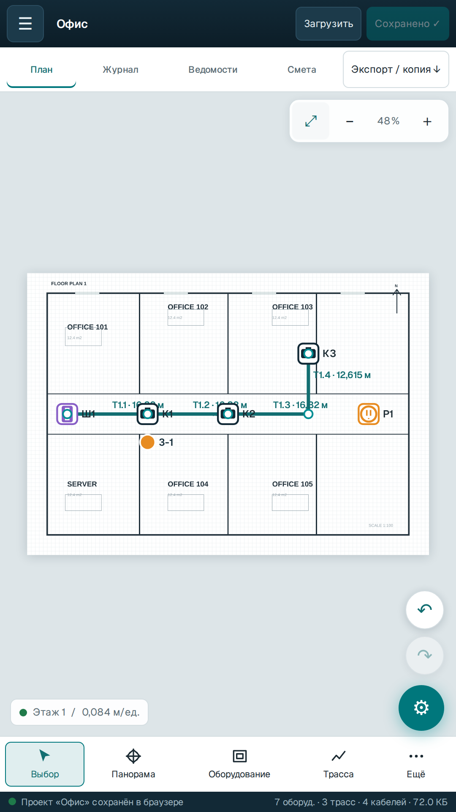

# AnOOPlan — кабельные планы и смета без интернета

**AnOOPlan** — офлайн-приложение для проектировщиков и монтажников слаботочных систем: загрузите
PDF-план здания, расставьте оборудование (камеры, шкафы), проведите трассы (лоток, гофра, труба,
кабель-канал) и получите кабельный журнал, ведомости, спецификацию и смету прямо на объекте.
Одна кодовая база собирается как **APK для Android** и как **веб-версия** на GitHub Pages;
разрешение `INTERNET` не запрашивается, внешних сетевых запросов нет.

<p align="center">
  
</p>

<p align="center">
  <a href="https://github.com/enkolesnikov/AnOOPlan/releases/latest"></a>
  <a href="https://enkolesnikov.github.io/AnOOPlan/app/"></a>
  <a href="https://enkolesnikov.github.io/AnOOPlan/"></a>
  <a href="docs/HANDOFF.md"></a>
</p>

<p align="center"><b>Версия 2.9.1 · APK 1 612 488 Б (1,6 МБ) · Android 7.0+</b></p>

<p align="center"></p>

## Скачать и установить

- **APK:** [последний релиз](https://github.com/enkolesnikov/AnOOPlan/releases/latest) —
  `AnOOPlan-2.9.1.apk`, около **1,6 МБ** (1 612 488 Б), Android 7.0+ (minSdk 24, targetSdk 35,
  WebView 98+), без интернета и аналитики. SHA-256:
  `f98da8732c06f01510900746ea9ac370b269fbcb9e7aad65e4b639ab3f6e59d2`.
- **Сайт:** [enkolesnikov.github.io/AnOOPlan](https://enkolesnikov.github.io/AnOOPlan/) —
  возможности, скриншоты и загрузка.
- **Веб-версия:** [enkolesnikov.github.io/AnOOPlan/app/](https://enkolesnikov.github.io/AnOOPlan/app/) —
  та же сборка; публикуется автоматически при изменениях приложения.
- **Документация:** [docs/HANDOFF.md](docs/HANDOFF.md) — состояние, архитектура, решения и техдолг.

Установка: скачайте APK на телефон → откройте файл → «Установить» (разрешите установку из этого
источника для браузера или файлового менеджера).

## Возможности

**Планы и чертёж**
- PDF-подложка: несколько страниц и этажей, калибровка по двум точкам, масштаб листа A4–A0.
- Приближение, панорамирование, сетка и привязка; рулетка и площадь контура.
- Отмена/повтор, поиск и фильтры (`Ctrl+K`), дублирование (`Ctrl+D`), горячие клавиши.
- Трассы: разделение по вершине, объединение с проверкой стыка, разворот, вставка/удаление вершин.
- Размеры: между оборудованием, цепочка, межэтажные с учётом отметок и высот.

**Оборудование, трассы, кабели**
- Камеры, шкафы и произвольные типы; уникальные номера, иконки, цвета, фотографии.
- Типы КНС (лоток, гофра, труба, кабель-канал) и своё сечение на каждом сегменте.
- Автопрокладка по графу трасс, запасы в процентах/метрах, концевые запасы.
- Заполнение КНС по каждому сегменту с предупреждениями 40 % и 50 %.
- Спецификация КНС по подсистемам, сечениям, артикулам и производителям.
- Смета: оборудование, кабели, лотки, работы по проценту; неизвестная цена не подменяется нулём.

**Документы и экспорт**
- PDF: титул, оглавление (многостраничное), штамп ГОСТ 2.104, журнал, ведомости, смета,
  коммерческое предложение, планы этажей, фотографии, лист регистрации изменений.
- XLSX (12 листов), CSV с десятичной запятой для русского Excel, `.anooplan` со всеми вложениями
  и SHA-256 манифестом.
- Печать выбранных разделов через системный диалог Android.
- История версий: автоснимки, восстановление, до 20 версий на проект.

**Надёжность**
- Автосохранение и защита от потери при выходе; удаление объектов не стирает вложения в обход undo.
- GC учитывает текущий проект, undo/redo, сохранённые проекты, снимки и черновик другой вкладки.
- Импорт переназначает ключи вложений; битые Base64 и подмена манифеста видны пользователю.
- Индикатор занятого места и отказ при заполнении хранилища ≥ 90 %.

## Офлайн и безопасность

- В манифесте нет `INTERNET`; единственное разрешение — `VIBRATE`.
- `allowBackup=false`, `debuggable=false`, `usesCleartextTraffic=false`.
- WebView не имеет файлового доступа; ShareProvider не экспортирован и проверяет path traversal.
- CSP в `index.html`; внешние шрифты и CDN не используются.
- Локальный сервер (`npm start`) по умолчанию слушает `127.0.0.1`; LAN-режим требует токен
  `ANOOPLAN_TOKEN`, токен из ссылки сохраняется в session-cookie.
- `npm audit`: 0 high; 9 moderate — только dev-цепочка ESLint (`minimatch`), в APK не входит.

## Что нового в 2.9.1 «Точность и скорость»

Релиз закрывает остатки аудита 2.9: углы, цены, миграции, скорость и экспорт. Заметки —
[RELEASE-NOTES-2.9.1.md](docs/RELEASE-NOTES-2.9.1.md), полный отчёт — [AUDIT-2.9.md](docs/AUDIT-2.9.md).

- **Углы:** цепочка строится в обе стороны, стояк не рвёт её; после разделения трассы угол на стыке
  считается один раз, а не теряется. Демо: Т1 = 1, Т3 = 1, «Лоток» = 2.
- **Цены по сечениям:** `PriceItem.size` сопоставляется с «100×50»/«Ø20»; смета даёт отдельные строки
  «Лоток · 100×50» и «Стояк · 50×50». Чужое сечение — `—` и предупреждение, а не первая цена.
- **Данные:** `quantity=0`/`NaN` и запасы не подменяются; в журнале/CSV/PDF — прочерк. Подбор сечения
  не учитывает неполные данные и кабели соседних сегментов.
- **Скорость:** drag через rAF, `totals` из `cableCalcs`, индекс `trayFill` (11,6 → 1,9 мс), кэш
  индекса сегментов; drag в браузере 16,7 мс/кадр (0 long tasks), ввод — 40–46 мс/символ;
  остаток рендера 9655 узлов, culling в 3.0.
- **Экспорт и сервер:** warnings-лист с `domainWarnings`, безопасное имя файла, `idb:`-PDF на сервере
  получает content-addressed id; хешированные ассеты кэшируются, HTML — нет.
- **Проверки:** 394 теста (+72 к 2.9.0), 11 E2E (+3), 4 визуальных эталона; `tsc`, ESLint, knip — чисто.

Предыдущий релиз [2.9.0 «Аудит и надёжность»](docs/RELEASE-NOTES-2.9.0.md) закрыл 15 дефектов
данных, расчётов, PDF и LAN-режима.

## Проверки и метрики

| Показатель | Значение |
|---|---|
| Юнит-тесты | **394** (`npm test`, ~2,5 с) |
| Смоук | **235** проверок (`npm run smoke`) |
| E2E / визуальные | **11** / **4** (`npm run test:ui`, `npm run test:visual`) |
| Покрытие | 94,0 / 87,5 / 94,2 % по тестируемым модулям (пороги 93/85/92); 61,8 % по всем `src/` |
| Стартовый бандл | **493,2 КБ JS** + **40,9 КБ CSS** (бюджеты 600/60) |
| APK | **1 612 488 Б**, versionCode 46, minSdk 24, targetSdk 35; SHA-256 `f98da873…6e59d2` |
| CI на push | lint → knip → tsc → покрытие → сборка/размер → смоук → E2E, ~110 с (бюджет 130) |

## Запуск локально

Требуется **Node.js 22.5+** (встроенный `node:sqlite`); проверено на Node 24.

```bash
npm install
npm run build        # tsc --noEmit + vite build → dist/
npm start            # API + статика на http://127.0.0.1:3001
```

Режим разработки (Vite на :5173 + API на :3001):

```bash
npm run dev
```

Dev-сервер по умолчанию слушает `127.0.0.1`. Для доступа с телефона задайте `VITE_HOST=0.0.0.0`
осознанно: Vite проксирует API без токена.

## Веб-версия

Веб-приложение: **https://enkolesnikov.github.io/AnOOPlan/app/** (лендинг — в корне).
Работает без бэкенда: проекты — в localStorage, PDF/фото — в IndexedDB; экспорт полностью
клиентский. Публикация — `deploy.yml` при изменениях `src/`, `landing/`, `index.html` и зависимостей.

## Android APK

APK — нативная оболочка (WebView) вокруг той же статической сборки, без Gradle:

- `com.anooplan.app`, versionCode 46, версия 2.9.1;
- ассеты отдаются по origin `https://appassets.local/`, поэтому работают localStorage, IndexedDB
  и `crypto.randomUUID()`;
- экспорт PDF/XLSX/CSV/`.anooplan` собирается на телефоне и сохраняется через MediaStore;
- сборка: `npm run build:apk` → `build/AnOOPlan-2.9.1.apk`; инструменты — в `tools/`, без Gradle.

## Документация

- [HANDOFF.md](docs/HANDOFF.md) — состояние, решения, инфраструктура, техдолг.
- [ROADMAP.md](docs/ROADMAP.md) — план 2.9.x/3.0, бюджеты, критерии приёмки.
- [AUDIT-2.9.md](docs/AUDIT-2.9.md) — свежий аудит и статус находок 2.8.1.
- [AUDIT-2.8.1.md](docs/AUDIT-2.8.1.md) — предыдущий независимый аудит.
- [REPORT-AUDIT.md](docs/REPORT-AUDIT.md) — отчёт прогона: коммиты, метрики, риски.
- [ARCHITECTURE.md](ARCHITECTURE.md) — модель данных, формулы, API.
- [RELEASE.md](docs/RELEASE.md) — процесс релиза.

## История версий

| Версия | Тема | Итог |
|---|---|---|
| 2.9.0 | Аудит и надёжность | данные, расчёты, PDF, LAN-токен и restore; 319 тестов, APK 1 608 392 Б |
| **2.9.1** | **Точность и скорость** | углы, цены по сечениям, миграции, drag/ввод, тесты хуков; 394 теста |
| 2.8.5 | Трассы и размеры | разделение/объединение, цепочка, межэтажные размеры; 294 теста, APK 1 608 392 Б |
| 2.8.4 | Вершины и привязки | удаление вершины, разворот, маркер привязки |
| 2.8.3 | UX-аудит | фокус/Back, мобильная панель, вкладки экспорта, AA |
| 2.8.2 | Надёжность | save-and-exit, вложения/undo, серверный экспорт, LAN |
| 2.8.1 | Аудит | честное покрытие, IndexedDB, CSP, DPI-растр |
| 2.8.0 | Medeo и вершины | UI-шрифт, вставка вершины |
| 2.7.0 | Мастера и шаблоны | онбординг, шаблоны, комплекты, импорт XLSX/CSV |
| 2.6.x | Скорость и списки | поиск, undo по действиям, мультивыбор, декомпозиция |
| 2.5.0 | Поле и доступность | сегментные размеры, textZoom, тёмная тема |

## Лицензии

Шрифты PDF — сабсеты PT Sans (OFL, переименованы в AnOOPlan Sans). UI-шрифт Medeo Sans — SIL OFL 1.1
(атрибуция в «О программе»). Сторонние библиотеки — в `package.json`; приложение не содержит
сетевых SDK.
